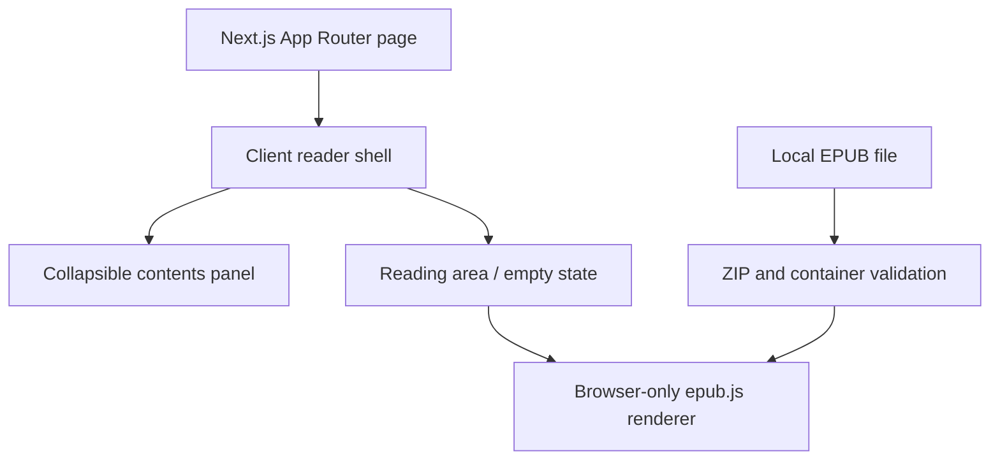

# Local EPUB Reader

A local-first EPUB reader built with Next.js App Router, TypeScript and React.

## Run

Use Node.js 20.9+ (Node.js 22 LTS recommended) and npm.

```sh
npm ci
npm run dev
```

Open http://localhost:3000. For production, run `npm run build` then `npm start`.

## Validate

```sh
npm test
npm run typecheck
npm run build
npm run test:e2e
```

## Architecture



## Current scope and limitations

Import one EPUB and read its contents by scrolling. Importing another book replaces
the current book. Invalid archives show an error and keep the current book.
Book scripts are disabled via the renderer's iframe sandbox. EPUB code only loads
in the browser. DRM-protected EPUBs are unsupported.

Refresh currently clears the book. Persistence, page buttons, chapter navigation,
settings, a standalone sample EPUB and Docker support remain future increments.
No backend, external API or remote font is used.

Browser tests require Microsoft Edge (`npx playwright install msedge` if absent).
They generate a small EPUB in memory to check rendering, replacement, invalid input,
and script sandboxing. An additional test uses the optional root-level file
`Alice's Adventures in Wonderland by Lewis Carroll.epub` when present. Root EPUBs
are ignored by Git and are never served as public assets.
