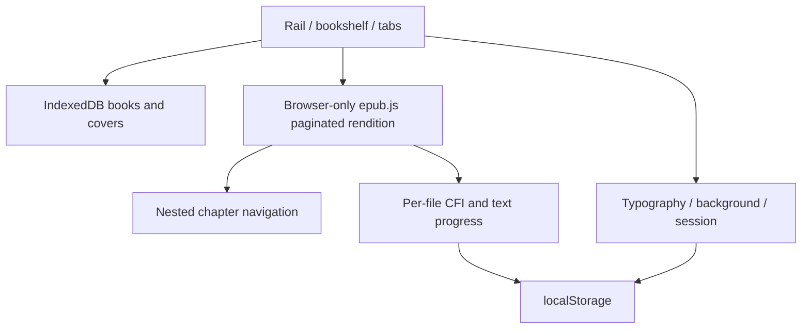

# Local EPUB Reader

## Docker (Linux)

Prerequisites: Docker Engine with the Compose plugin, and network access to
Docker Hub and the npm registry for the first build. From the source directory:

```sh
docker compose up -d --build
```

The multi-stage build installs locked dependencies and produces a standalone
Next.js server on Node.js 22. The runtime runs as a non-root user and includes
a healthcheck. Check readiness with `docker compose ps` and logs with
`docker compose logs --tail=100 reader`. Stop with `docker compose down`.
Use `READER_PORT=3001 docker compose up -d --build` if port 3000 is occupied.

Run the repeatable Linux smoke test (build, readiness, HTTP and static assets):

```sh
sh scripts/docker-smoke.sh
```

The port binds to loopback only: http://localhost:3000 on the Docker host.
This is a Linux Docker startup validation, not a public deployment. Browser
book storage stays in IndexedDB/localStorage; no server data volume is needed.
Remote browser access would separately require HTTPS or an SSH localhost tunnel
because EPUB identifiers use Web Crypto. Books, environment files and local
build output are excluded from the image context. No database is required.

A browser-local EPUB bookshelf and paginated reader using Next.js App Router,
TypeScript, React and epub.js. No backend, external API or remote fonts.

## Run

Use Node.js 22 LTS and npm:

```sh
npm ci
npm run dev
```

Open http://localhost:3000. Production: `npm run build` then `npm start`.

## Read

- Import one or multiple EPUBs. The bookshelf shows covers (or a title placeholder)
  and reading progress. Identical file bytes are deduplicated.
- Open books into tabs. Switch tabs to resume each book independently. Close a tab
  without deleting the book; the upper-right close button returns to the bookshelf.
- Use Select, optional Select all, and Delete selected to remove books locally.
- The left rail opens chapter navigation, typography, or background preferences.
- Typography includes single/double page, serif/sans-serif, 14–28 px size and line
  height 1.4–2.2. Double-page layout needs sufficient horizontal space.
- Read using Previous/Next or the mouse wheel (down: next, up: previous), with no content scrolling. Wheel gestures are throttled to avoid skipping pages. Footer numbers refer to the
  current chapter's dynamically laid out pages; percentage refers to the whole
  book's text locations, calculated locally after loading. Pagination changes
  with viewport and typography; these are not fixed print page numbers.
- Light/dark colors apply to the interface and book; images are not inverted.

## Persistence and limitations

IndexedDB stores books and covers under SHA-256 file identifiers. localStorage
stores per-book EPUB CFI anchors, percentages, open tabs and display preferences.
The previous single-book record is migrated into the bookshelf automatically.
Refresh restores tabs, active book, settings and progress. Returning to the shelf
persists that choice. Clearing browser site data deletes this local library.

CFI restoration opens the page containing the target paragraph. The original anchor
is retained during reflow until the next page turn or chapter jump to avoid drift.
Progress is approximate by text locations, not physical page count. Changing
layout briefly reloads the rendition. Book scripts are disabled in sandboxed
iframes. DRM-protected EPUBs and PDF are unsupported. No accounts, cloud sync,
search, annotations or AI features. The user waived the standalone sample EPUB. See Docker instructions below.

## Architecture



## Verify

```sh
npm test
npm run typecheck
npm run build
npm run test:e2e
```

Browser tests use Microsoft Edge (`npx playwright install msedge` if needed).
They generate EPUBs in memory and verify the shelf, tabs, independent progress,
pagination, styles, refresh, deduplication, corruption, multi-delete, migration,
delete failure and narrow viewports. The optional root-level
`Alice's Adventures in Wonderland by Lewis Carroll.epub` adds real-book cover,
chapter and page-turn checks. Root EPUB files are ignored and not publicly served.

## Display refinements

Shelf captions occupy two lines with truncation; hovering reveals the full title.
Older migrated records automatically re-extract missing cover metadata from their
local EPUB once, preserving identifiers and progress. Books genuinely lacking a
cover retain the title placeholder. Theme controls separate light/dark interface
mode and five accent colors from the reading background (white, paper, green, blue, or night); all selections persist independently.

Shelf progress bars sit directly below each cover, before the fixed-height caption.
The former follow-theme background migrates once to white or night; subsequent
interface theme changes leave the chosen reading background unchanged.

## Acceptance

See [ACCEPTANCE.md](ACCEPTANCE.md) for the two-real-book acceptance results and
verification limits. A self-authored sample EPUB is waived.
