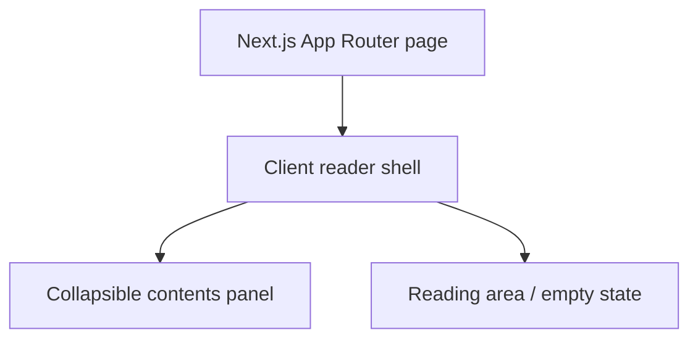

# Local EPUB Reader

A local-first EPUB reader built with Next.js App Router, TypeScript and React.

## Run

Use Node.js 20.9+ (Node.js 22 LTS recommended) and npm.

```sh
npm ci
npm run dev
```

Open http://localhost:3000. For production, run `npm run build` then `npm start`.

## Validate

```sh
npm test
npm run typecheck
npm run build
```

## Architecture



## Current scope and limitations

This first increment provides the runnable shell and collapsible contents panel.
Import and settings buttons are disabled until their features are implemented.
EPUB rendering, browser storage, sample EPUB and Docker support are planned for
subsequent increments. No backend, external API or remote font is used.
