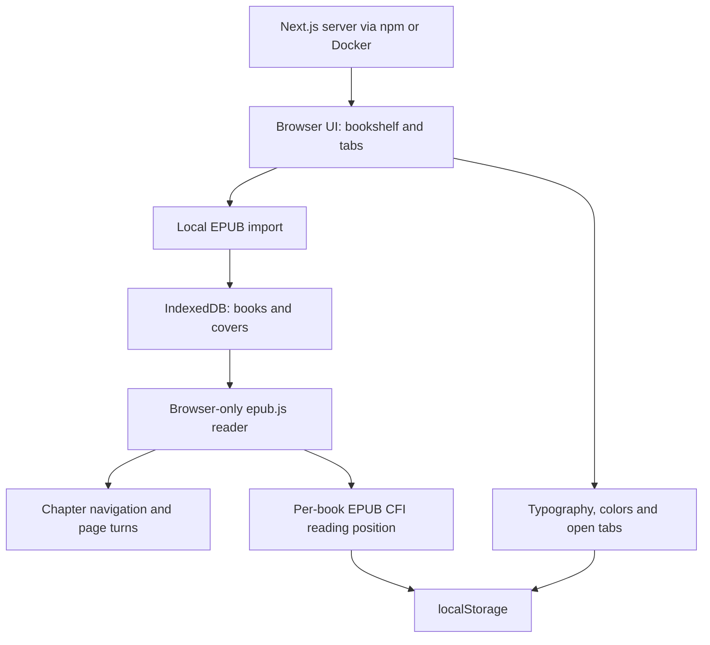

# Local EPUB Reader

## Introduction

A browser-local EPUB bookshelf and reader built with Next.js App Router,
TypeScript, React and epub.js. Import EPUBs, read in tabs, navigate chapters,
turn pages and adjust typography and colors. Books are saved in IndexedDB;
reading positions and preferences are saved in localStorage and restored after
refresh. No backend, database service or external API is required.

The two test books are in `ebook/` and are included in Docker at `/app/ebook/`.
Import them through the browser to read; they are not automatically added to the
bookshelf. Clearing browser site data removes saved books and preferences.

## Startup

### npm

Environment: Node.js 22.x and npm 10.x. Verified on Windows and directly on
Ubuntu 22.04 with Node.js 22.23.4 and npm 10.9.9. Initial dependency installation
requires access to the npm registry. Run from the project directory:

```sh
npm ci
npm run dev
```

For a production build and server:

```sh
npm ci
npm run build
npm start
```

Open http://localhost:3000 in a browser. Use localhost or HTTPS for browser
reading features, which require Web Crypto. The standalone output configuration
may produce an npm start recommendation from Next.js; the npm production path
has been verified to serve the page and static assets.

### Docker

Environment: Linux Docker Engine and the Docker Compose plugin (`docker compose`).
Verified on Ubuntu 22.04 x86_64 with Docker 29.5.3 and Compose v5.1.4. Node.js and
npm are provided inside the image; they are not required on the host. The first
build requires access to Docker Hub and the npm registry.

Build and start from the project directory:

```sh
docker compose up -d --build
```

Open http://localhost:3000 on the Docker host. The port binds to host loopback.
Check status with `docker compose ps`; stop with `docker compose down`.
No database or server data volume is required because book data stays in the browser.

## Architecture


